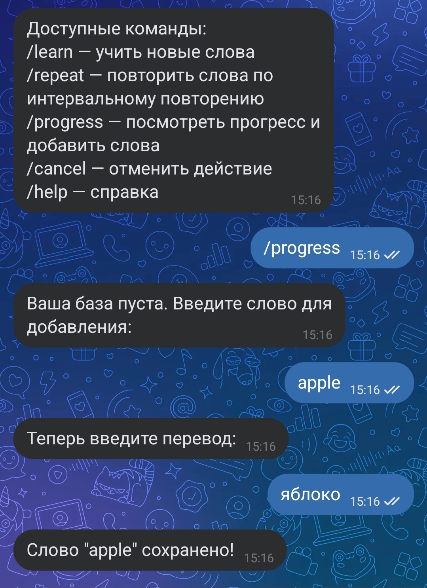
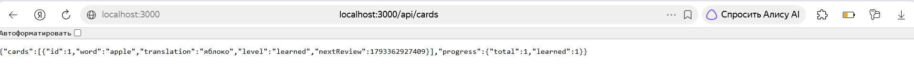

# WordTrainerBot

Бот-тренажер иностранных слов для ВКонтакте с карточками и интервальными повторениями.

## Описание проекта

Проект представляет собой бота для изучения иностранных слов. Пользователь может добавлять новые слова, просматривать их в виде карточек и повторять по алгоритму интервальных повторений. Взаимодействие с ботом построено на основе конечного автомата (state machine). Также реализован REST API для управления базой карточек.

## Функциональные возможности

### VK-бот:
- **`/learn`** — показывает карточку слова. Позволяет перевернуть карточку, чтобы увидеть перевод.
- **`/repeat`** — показывает слова для повторения по алгоритму интервальных повторений (сортирует карточки по уровню запоминания).
- **`/progress`** — показывает статистику (сколько слов выучено из общего числа) и позволяет добавить новое слово.
- **`/help`** и **`/start`** — вывод списка доступных команд.

### API-сервис:
- **`GET /api/cards`** — получить список всех карточек и статистику прогресса.
- **`POST /api/cards`** — добавить новую карточку. Принимает JSON `{ word, translation }`.

## Используемые технологии
- **Node.js** (ES6 Modules — `import`/`export`)
- **VK-IO** — библиотека для работы с VK API
- **Express** — веб-фреймворк для реализации REST API
- **Jest** — фреймворк для написания тестов
- **ESLint** — инструмент для проверки чистоты кода

## Инструкция по запуску

1. Установите все зависимости командой: npm install

2. Создайте файл .env в корневой папке проекта на основе файла .env.example и заполните его своими данными:
VK_GROUP_TOKEN = 'ваш_токен_сообщества'
VK_GROUP_ID = 'id_вашего_сообщества'
PORT = 3000

3. Запустите проект командой: npm start
После запуска API будет доступно по адресу http://localhost:3000, а бот начнет отвечать на сообщения в VK.

4. Для проверки тестов и покрытия кода используйте команды: 
npm test
npm run test:coverage

5. Для проверки линтера используйте команду: npm run lint

## Примеры работы

### 1. Добавление нового слова
Пользователь вводит команду для добавления слова, бот запрашивает само слово и его перевод.

### 2. Изучение слов (карточки)
Бот показывает слово, затем по запросу пользователя переворачивает карточку и показывает перевод.

### 3. Работа API-сервиса
Пример GET-запроса к API через браузер. Возвращается JSON-массив с карточками и статистикой.

