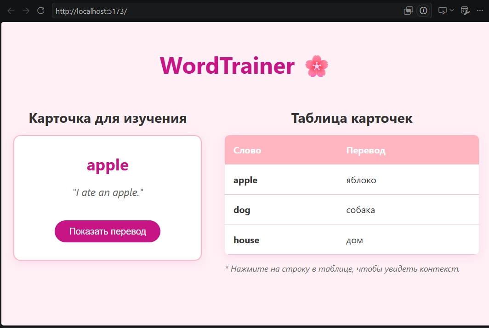
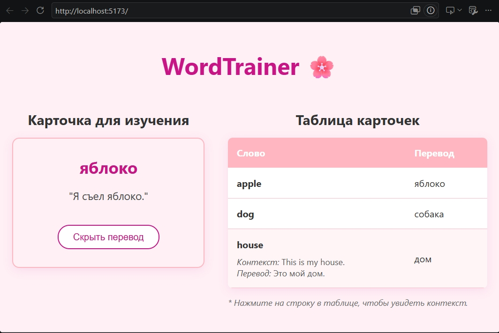

# WordTrainer (React)

Лабораторная работа №4. Разработка компонентов на React (TypeScript).

## Описание проекта
Приложение представляет собой интерфейс для изучения иностранных слов (WordTrainer). 
Реализовано два основных компонента: таблица карточек и карточка для изучения. Приложение написано на React с использованием TypeScript и чистого CSS (без сторонних UI-библиотек).

## Функциональность
1. **Таблица карточек со словами**: отображает список слов и их переводы. При клике на строку раскрывается дополнительная информация (контекст использования слова и его перевод).
2. **Карточка для изучения**: отображает слово и контекст его использования. При нажатии на кнопку карточка переворачивается и показывает перевод слова и перевод контекста.

## Инструкция по запуску
1. Перейдите в папку с проектом:
   cd frontend
2. Установите зависимости:
   npm install
3. Запустите сервер разработки:
   npm run dev
4. Откройте приложение в браузере (обычно http://localhost:5173).
5. Для запуска тестов:
   npm test

## Скриншоты работы

### Главный экран приложения

### Взаимодействие (переворот карточки и раскрытие строки)
